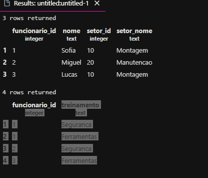
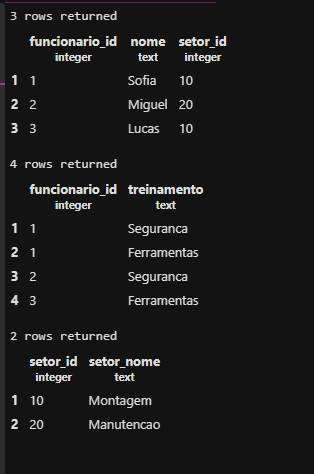

## Normalização de banco de dados
Objetivo: normalizar um banco de dados com problemas de organização de registros.

1- Primeiro criamos um banco de dados:
```sql
CREATE DATABASE empresa;
```
2- Criamos a tabela original 
```sql
 CREATE TABLE cadastro_original (
    funcionario_id INTEGER PRIMARY KEY,
    nome TEXT,
    setor_id INTEGER,
     setor_nome TEXT,
     treinamentos TEXT
);
```
3- Inserimos os dados na tabela
```sql
INSERT INTO cadastro_original VALUES
(1,'Sofia',10,'Montagem','Seguranca;Ferramentas'),
(2,'Miguel',20,'Manutencao','Seguranca'),
(3,'Lucas',10,'Montagem','Ferramentas');
```

4- Ao realizar a primeira consulta, verifimos que a Sofia está com dois registros na mesma linha!!!

```sql
SELECT * FROM cadastro_original
ORDEM BY 
```

5- Criamos uma nova tabela com a nova norma normal 
```sql
CREATE TABLE cadastro_1fn AS 
SELECT funcionario_id,nome,setor_id,setor_nome,
 string_to_table(treinamentos, ';') AS treinamento 
 FROM cadastro_original;
```

6- Ajeitamos a tabela 
```sql
ALTER TABLE cadastro_1fn
ADD PRIMARY KEY (funcionario_id, treinamento);
```

### 2FN

1- Primeiros criamos a tabela de funcionarios
```sql
CREATE TABLE funcionarios AS
SELECT DISTINCT funcionario_id,nome,setor_id,setor_nome
FROM cadastro_1fn;
```
> O DISTINCT evita copiar linhas iguais mais de uma vez. Ou seja: os dois treinamentos da Sofia viram um só.

2- O comando CREATE TABLE AS não traz as chaves primarias automaticamente, dessa forma executamos o comando 
```sql
ALTER TABLE funcionarios
ADD PRIMARY KEY (funcionario_id);
```

3- Criamso a tabela participacoes, trazendo apenas o ID do funcionario e o seus treinamentos.
```sql
CREATE TABLE participacoes AS SELECT funcionario_id,treinamento FROM cadastro_1fn;
```

4- Adicionamos as chaves primarias
```sql
ALTER TABLE participacoes
ADD PRIMARY KEY (funcionario_id,treinamento);
```

5- Adicionamos a chave estrangeiras (RELAÇOES ENTRE TABELAS)
```sql
ALTER TABLE participacoes
ADD FOREIGN KEY (funcionario_id) REFERENCES funcionarios(funcionario_id);
```

6- Comando para selecionar tabelas 
```sql
SELECT * FROM funcionarios;
select * from participacoes;
```
 como ficou 

### 3FN

O objetivo: separar os setores 

1- Criamos a tabela setores
```sql
CREATE TABLE setores AS SELECT DISTINCT setor_id,setor_nome
FROM funcionarios;
```

2- Adiconamos a chave primaria 
```sql
ALTER TABLE setores 
ADD PRIMARY KEY (setor_id);
```
3- Para a chave estrangeira 
```sql
ALTER TABLE funcionarios 
ADD FOREIGN KEY (setor_id) REFERENCES setores(setor_id);
```

4- Correção do erro na hora de criar a tabela 
```sql
ALTER TABLE funcionarios 
ALTER COLUMN setor_id SET NOT NULL;
```

5- Para deletar uma coluna 
```sql
ALTER TABLE funcionarios 
DROP COLUMN setor_nome;
```

6- Print do resultado 
 e o código
```sql
SELECT * FROM funcionarios;
SELECT * FROM participacoes;
SELECT * FROM setores;
```

7- Para mudar
```sl
UPDATE setores
SET setor_nome = 'producao'
WHERE setor_id = 10;
```