# Anotações — Normalização de Banco de Dados

# 1. Criando o banco de dados

Primeiro, criamos um banco de dados novo para fazer a atividade.

```sql
CREATE DATABASE empresa_sofia;
```


# 2. Criando a tabela original

Primeiro, criamos a tabela que guarda as informações dos funcionários.

```sql
CREATE TABLE cadastro_original (
    funcionario_id INTEGER PRIMARY KEY,
    nome TEXT,
    setor_id INTEGER,
    setor_nome TEXT,
    treinamentos TEXT
);
```

Depois, colocamos os dados na tabela.

```sql
INSERT INTO cadastro_original VALUES
(11, 'Sofia', 1, 'Producao', 'Integracao;EPI'),
(12, 'Pietro', 2, 'Qualidade', 'EPI'),
(13, 'Yasmin', 1, 'Producao', 'Integracao');
```

Depois, fizemos a consulta:

```sql
SELECT * FROM cadastro_original;
```

O problema é que a Sofia tem dois treinamentos juntos na mesma coluna: Integração e EPI. Por isso, precisamos organizar os dados.

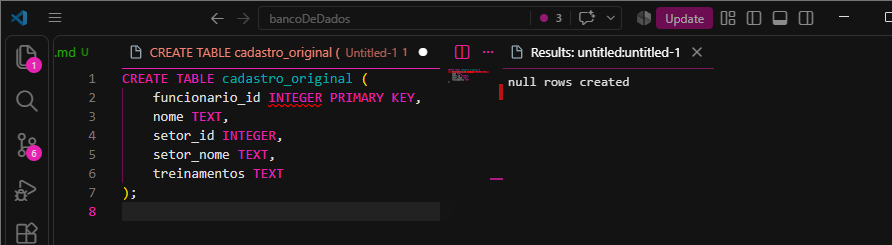
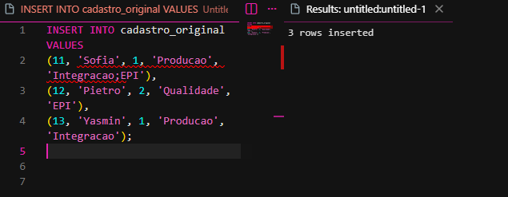
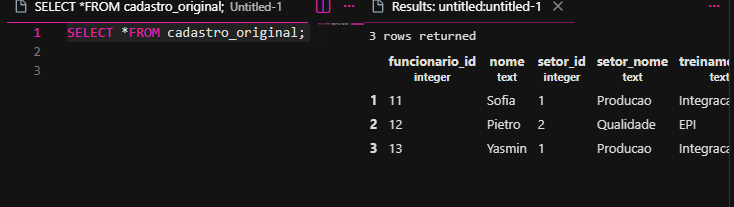

# 3. Primeira Forma Normal (1FN)

A 1FN serve para deixar apenas um valor em cada campo. Por isso, separamos os treinamentos.

```sql
CREATE TABLE cadastro_1fn AS
SELECT
    funcionario_id,
    nome,
    setor_id,
    setor_nome,
    STRING_TO_TABLE(treinamentos, ';') AS treinamento
FROM cadastro_original;
```

Depois, adicionamos a chave primária:

```sql
ALTER TABLE cadastro_1fn
ADD PRIMARY KEY (funcionario_id, treinamento);
```

Por último, consultamos a tabela:

```sql
SELECT * FROM cadastro_1fn
ORDER BY funcionario_id, treinamento;
```

Agora, cada linha tem apenas um treinamento, e nenhuma participação foi perdida.

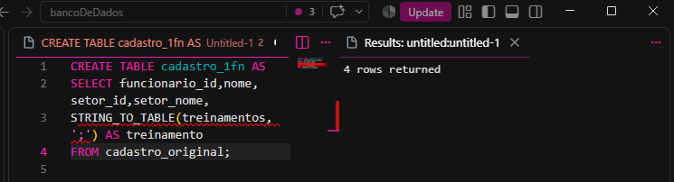
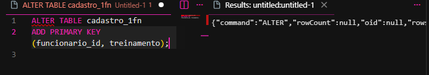
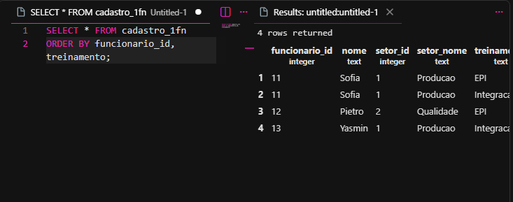

# 4. Segunda Forma Normal (2FN)

Na 2FN, separamos as informações dos funcionários das informações dos treinamentos.

## 5. Criando a tabela funcionarios

```sql
CREATE TABLE funcionarios AS
SELECT DISTINCT
    funcionario_id,
    nome,
    setor_id,
    setor_nome
FROM cadastro_1fn;
```

```sql
ALTER TABLE funcionarios
ADD PRIMARY KEY (funcionario_id);
```

Assim, cada funcionário tem seu próprio identificador.

Depois, consultamos a tabela:

```sql
SELECT * FROM funcionarios;
```

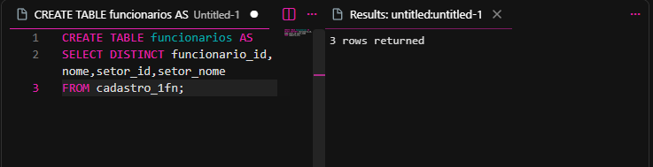
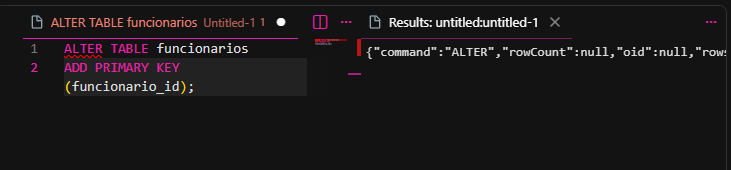
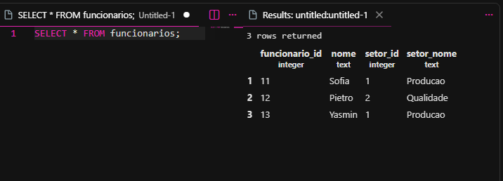

## 6. Criando a tabela participacoes

Agora, criamos uma tabela que guarda somente o funcionário e o treinamento que ele fez.

```sql
CREATE TABLE participacoes AS
SELECT
    funcionario_id,
    treinamento
FROM cadastro_1fn;
```

Depois, adicionamos a chave primária:

```sql
ALTER TABLE participacoes
ADD PRIMARY KEY (funcionario_id, treinamento);
```

Depois, adicionamos a chave estrangeira:

```sql
ALTER TABLE participacoes
ADD FOREIGN KEY (funcionario_id)
REFERENCES funcionarios(funcionario_id);
```

Por último, consultamos a tabela:

```sql
SELECT * FROM participacoes;
```

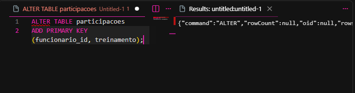
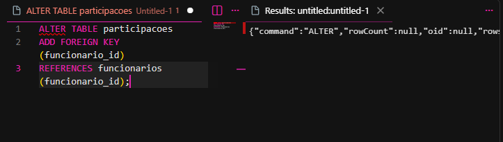
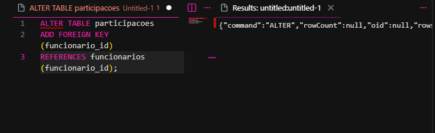


# 7. Terceira Forma Normal (3FN)

Na 3FN, separamos os setores em uma tabela própria para não precisar repetir o nome do setor em cada funcionário.

## 8. Criando a tabela setores

```sql
CREATE TABLE setores AS
SELECT DISTINCT
    setor_id,
    setor_nome
FROM funcionarios;
```

Depois, adicionamos a chave primária:

```sql
ALTER TABLE setores
ADD PRIMARY KEY (setor_id);
```

Depois, consultamos os setores:

```sql
SELECT * FROM setores;
```
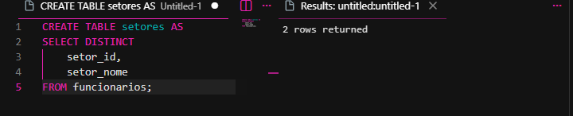
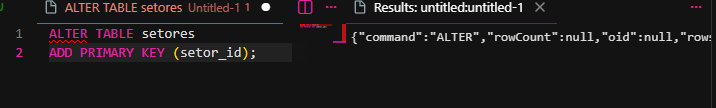


## 9. Tornando setor_id obrigatório

```sql
ALTER TABLE funcionarios
ALTER COLUMN setor_id SET NOT NULL;
```
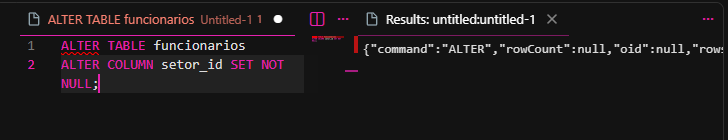

## 10. Criando a chave estrangeira dos setores

```sql
ALTER TABLE funcionarios
ADD FOREIGN KEY (setor_id)
REFERENCES setores(setor_id);
```
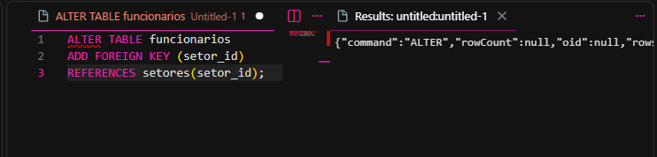
Esse comando liga a tabela `funcionarios` à tabela `setores`.

## 11. Removendo a coluna setor_nome

```sql
ALTER TABLE funcionarios
DROP COLUMN setor_nome;
```
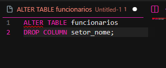

Removemos essa coluna porque o nome do setor já está guardado na tabela `setores`. 

# 12. Consultando as tabelas finais

Depois de terminar a normalização, consultamos as três tabelas.

```sql
SELECT * FROM funcionarios;
```

```sql
SELECT * FROM participacoes;
```

```sql
SELECT * FROM setores;
```

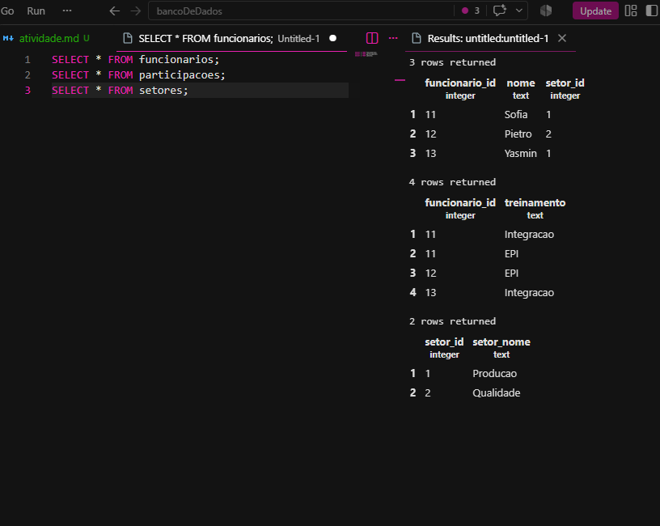