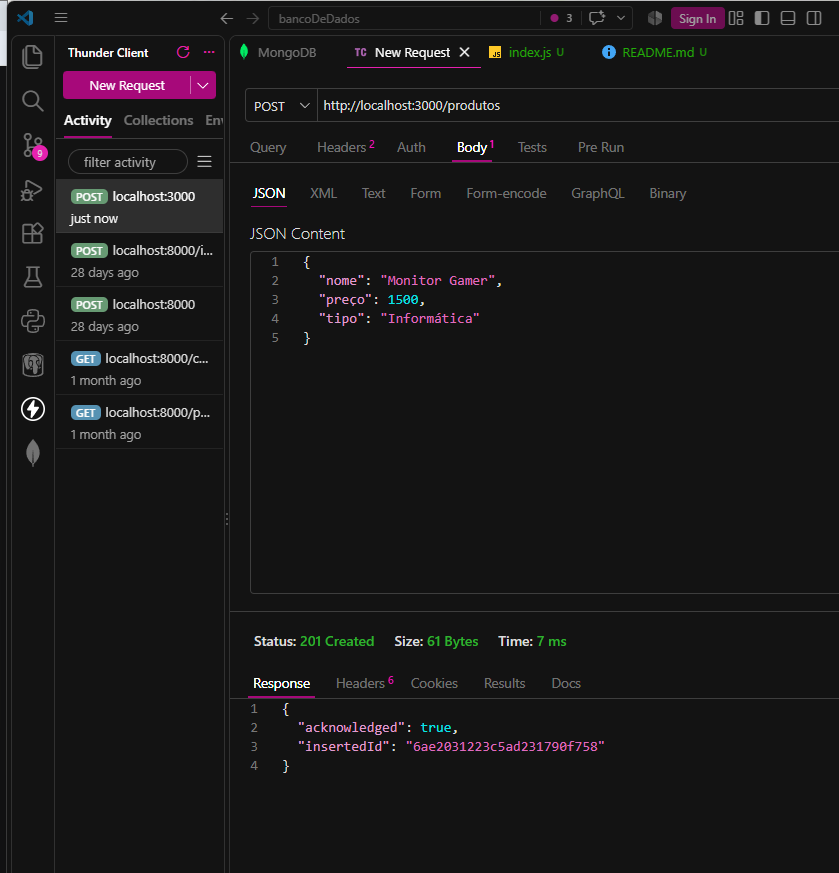
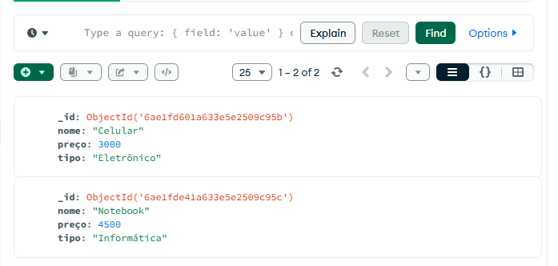
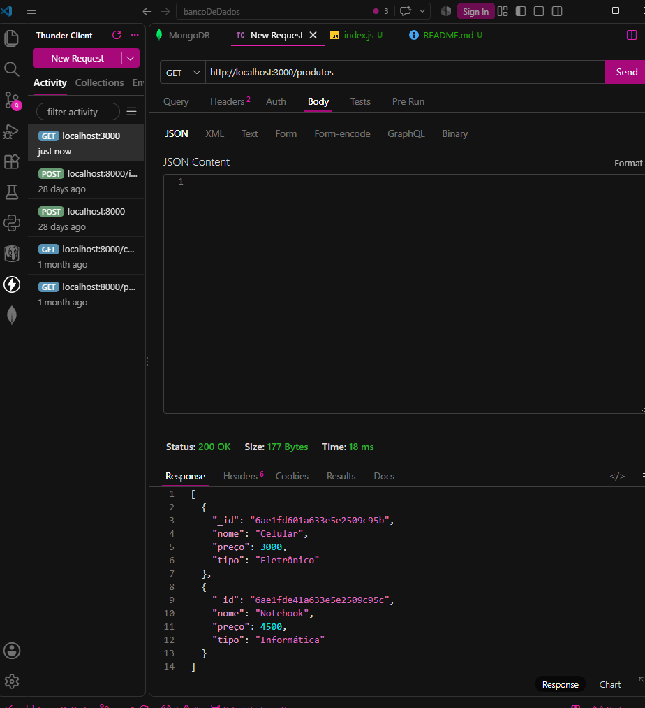
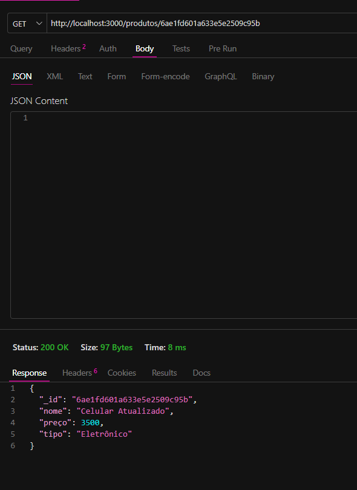
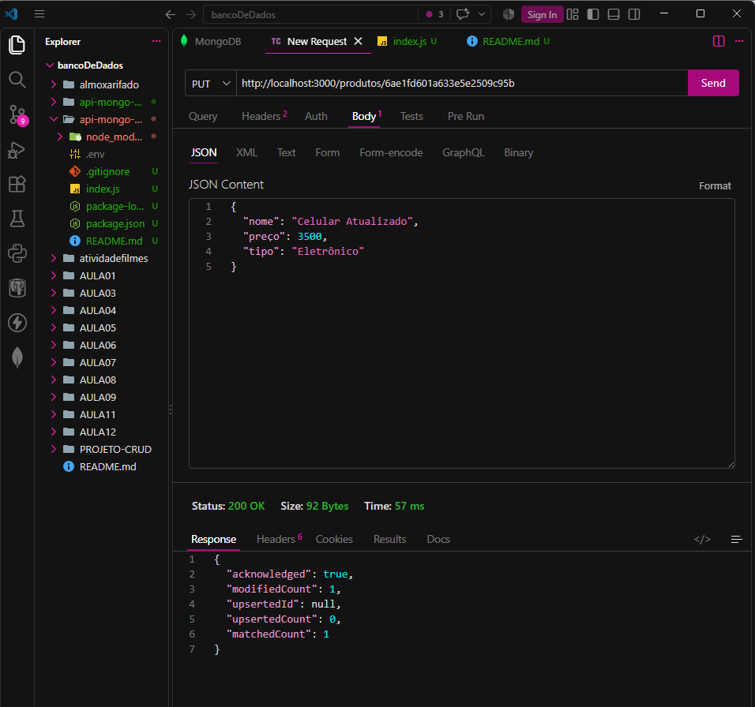
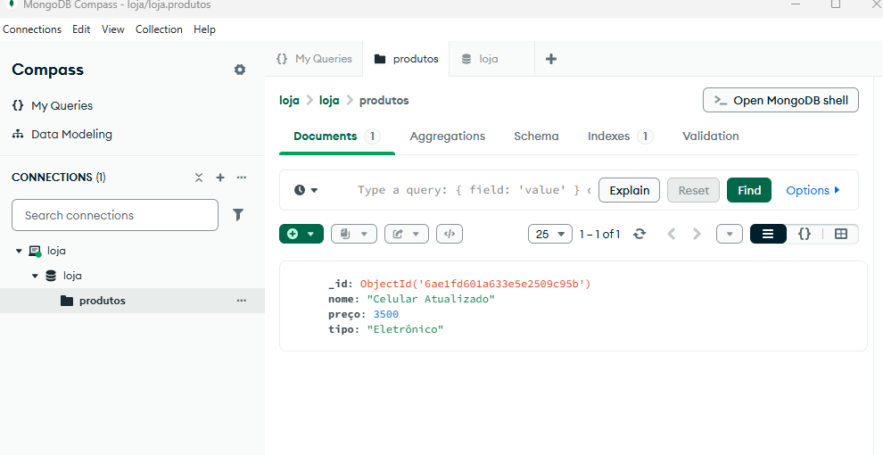
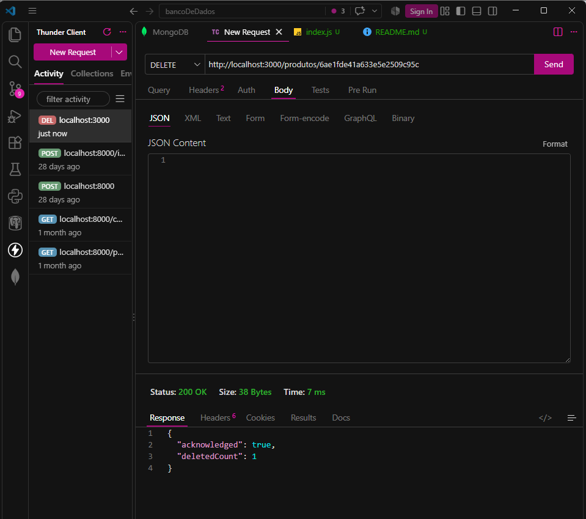

API de Produtos

API REST simples desenvolvida para cadastrar, listar, atualizar e deletar produtos no banco de dados MongoDB.

Tecnologias e Configuracoes

Node.js + Express: Criacao do servidor e rotas HTTP.

MongoDB: Banco de dados para armazenar os produtos.

Thunder Client: Ferramenta no VS Code para testar as requisicoes.

.env: Guarda a senha e endereco de conexao do banco em segredo.

.gitignore: Impede que o .env e pastas do projeto subam para o Git.

Como Executar

npm install
node index.js

Rotas da API e Exemplos de Uso

1. Criar Produto (POST)

Adiciona um novo item ao banco de dados.

URL: http://localhost:3000/produtos

Body (JSON):

{
  "nome": "Monitor Gamer",
  "preço": 1500,
  "tipo": "Informática"
}

2. Listar Todos os Produtos (GET)

Retorna a lista completa de produtos cadastrados.

URL: http://localhost:3000/produtos

Body: Não coloca nada

3. Buscar Produto por ID (GET)

Retorna apenas o produto correspondente ao ID informado.

URL: http://localhost:3000/produtos/o id do produto que voçê deseja ver

Body: Não coloca nada

4. Atualizar Produto (PUT)

Altera os dados de um produto existente utilizando o seu ID.

URL: http://localhost:3000/produtos/SEU_ID_AQUI

Body (JSON):

{
  "nome": "Celular Atualizado",
  "preço": 3200,
  "tipo": "Eletrônico"
}

5. Deletar Produto (DELETE)

Remove permanentemente um produto do banco de dados utilizando o ID.

URL: http://localhost:3000/produtos/SEU_ID_AQUI

Body: Não coloca nada

